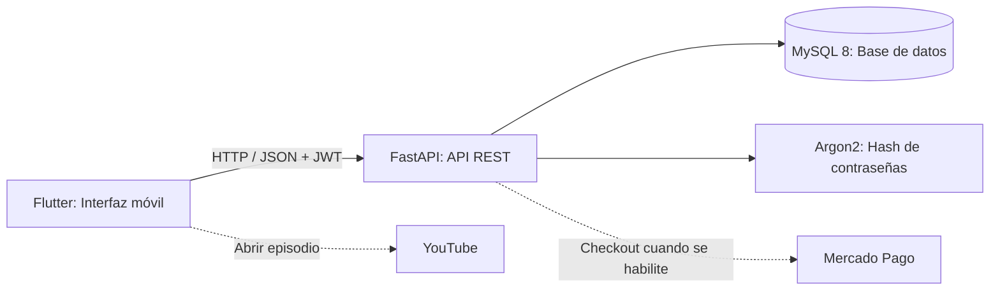
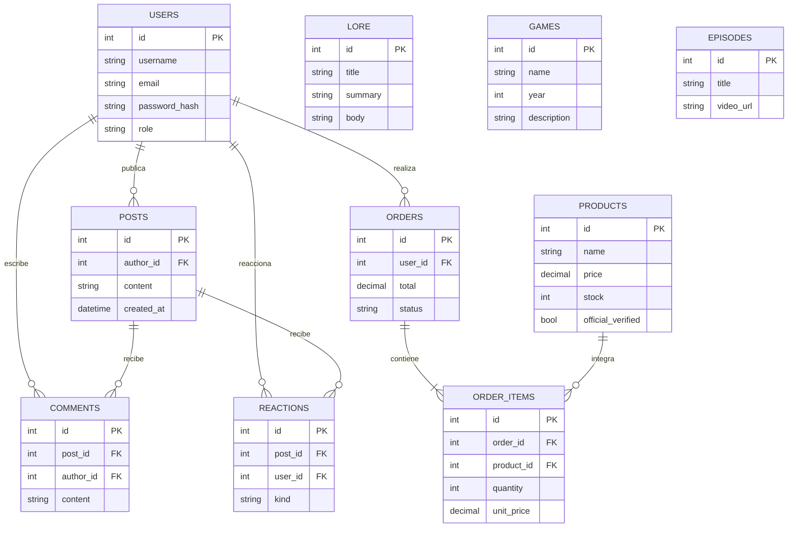
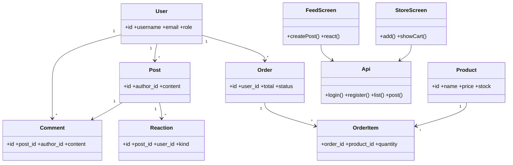

# Reporte técnico – Evaluación Unidad 3

**Proyecto:** Fazbear Archives — Vlog, lore, comunidad y tienda de FNAF  
**Tecnologías:** Flutter, FastAPI, MySQL, SQLAlchemy, JWT y Argon2  
**Integrantes:** [Completar]  
**Fecha:** [Completar]

> Plantilla basada en la rúbrica de la Unidad 3. Las evidencias de ejecución y la reflexión deben completarse con resultados reales del equipo. No se incluyen capturas inventadas.

## 1. Descripción del sistema

Fazbear Archives es una aplicación móvil educativa creada por fans para explorar el universo de *Five Nights at Freddy’s*. Muestra capítulos de lore, fichas de videojuegos y episodios narrativos enlazados desde YouTube. También incluye una comunidad donde los usuarios registrados publican teorías, comentan y reaccionan a entradas. Un módulo de tienda presenta un carrito y permite registrar pedidos de demostración. Los productos iniciales no son inventario oficial verificado y la API bloquea cualquier intento de pago real con ellos.

## 2. Diagrama general de arquitectura

Flutter no se conecta directamente a MySQL. Se comunica con la API mediante HTTP. FastAPI valida credenciales, permisos y pedidos y administra la lectura y escritura de los datos.

## 3. Modelo de datos

## 4. Diagrama de clases (simplificado)

## 5. Uso de sensores y recursos multimedia

**Cámara:** No es necesaria en el alcance funcional actual; las publicaciones son de texto. No se solicitan permisos de cámara.

**GPS:** No es necesario para consultar el lore, interactuar en la comunidad o crear pedidos de prueba. No se solicita ubicación.

**Multimedia:** Las pantallas utilizan iconos de Flutter y emojis como recursos gráficos. El vlog incluye enlaces a episodios públicos de YouTube que el usuario abre en un reproductor externo. La app no incluye recursos gráficos originales de la franquicia sin autorización.

**Librerías de Flutter:** `http` permite llamar a FastAPI, `flutter_secure_storage` conserva el token en almacenamiento seguro y `url_launcher` permite abrir episodios y enlaces de pago. Para backend se usa `SQLAlchemy` para los modelos, `pwdlib[argon2]` para hashing y `PyJWT` para tokens firmados.

## 6. Mecanismos de seguridad

- Las contraseñas se guardan como **hash Argon2**, nunca en texto claro (véase `backend/app/security.py`).
- FastAPI firma los tokens JWT con una clave privada de entorno y les define expiración.
- Endpoints sensibles de posts, comentarios, reacciones y pedidos comprueban el token mediante `current_user`.
- La administración está restringida a usuarios con rol `admin`.
- Flutter conserva el token en almacenamiento seguro y lo envía por encabezado `Authorization: Bearer ...`.
- El precio del pedido se calcula **en el servidor** a partir de MySQL, no del total mostrado por Flutter.
- El servidor nunca entrega `JWT_SECRET`, `MP_ACCESS_TOKEN` ni hashes de contraseña al dispositivo.
- Para un servidor público se necesita HTTPS, configuración segura de CORS, endurecimiento contra abuso y pruebas de seguridad adicionales.

## 7. Evidencia de acceso a datos

Agregar capturas **reales** después de ejecutar la aplicación. Recomendación:

1. Captura de MySQL mostrando las tablas `users`, `posts`, `comments`, `reactions`, `products`, `orders` y `order_items`.
2. Captura de la aplicación mostrando una publicación en Comunidad.
3. Captura de un comentario y una reacción creados desde el teléfono.
4. Captura del carrito y de un pedido registrado.
5. Captura de `http://localhost:8000/docs` mostrando endpoints y el resultado de una consulta.

**Fragmentos de código a citar en el documento final:**

- `flutter_app/lib/api.dart`: método `request`, autenticación y solicitudes HTTP.
- `backend/app/main.py`: `/posts`, `/posts/{post_id}/comments`, `/posts/{post_id}/reactions` y `/orders`.
- `backend/app/security.py`: `hash_password`, `create_token` y `current_user`.
- `backend/app/models.py`: tablas y relaciones SQLAlchemy.

## 8. Reflexión sobre el proceso de desarrollo

**Apartado por completar con la experiencia verdadera del equipo:**

- ¿Qué dificultades tuvieron al conectar Flutter con FastAPI por IP local?
- ¿Cómo comprobaron que los datos se guardaron en MySQL?
- ¿Por qué optaron por JWT y Argon2?
- ¿Qué aprendieron sobre reacciones, relaciones entre tablas y carrito?
- ¿Qué funciones agregarían en una siguiente unidad (subida de imágenes, moderación, pagos reales, envíos)?

## 9. Conclusión

Esta propuesta reúne los componentes centrales de la rúbrica: interfaz móvil, API REST, base de datos relacional y medidas de autenticación. Para documentar su funcionamiento en el reporte final se requieren las pruebas reales del equipo y las capturas. La parte de comercio se presenta inicialmente como demostración para evitar confundir un catálogo ficticio con ventas oficiales.
